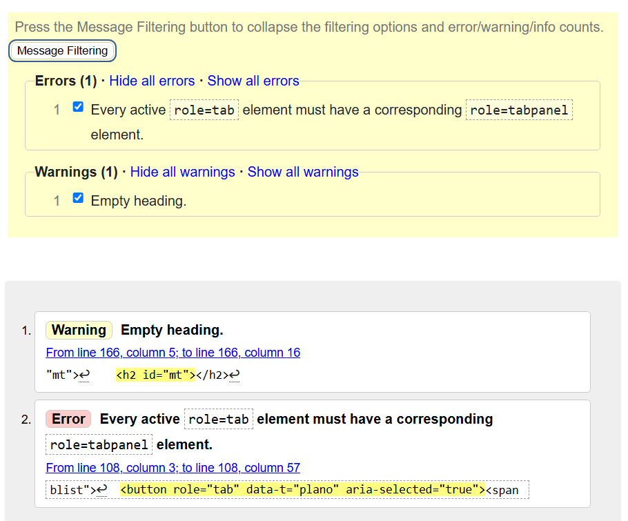
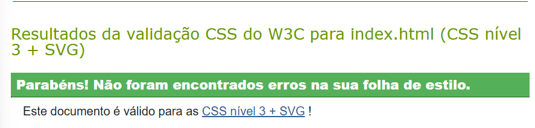
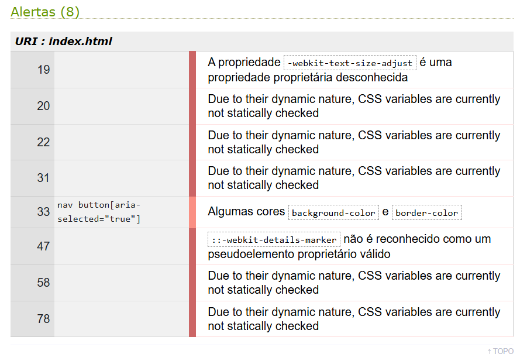
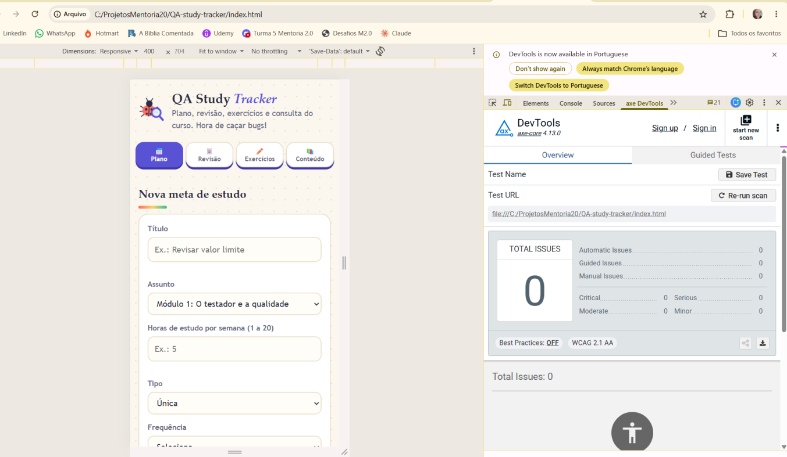
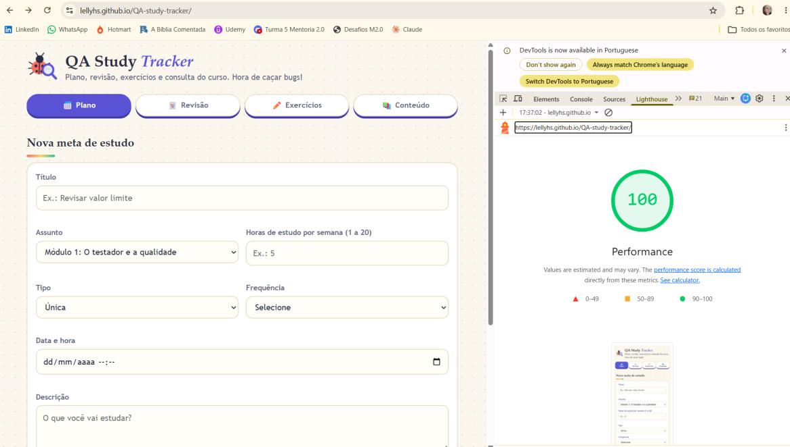
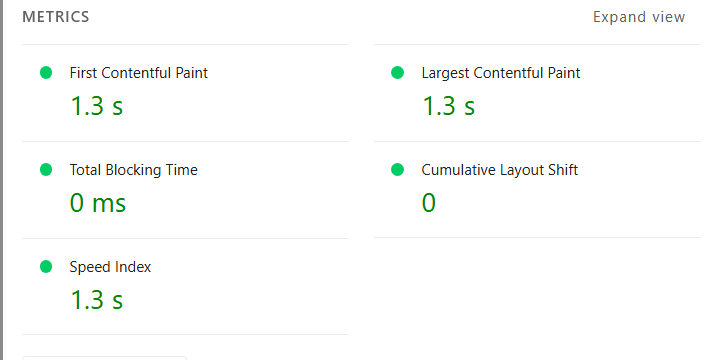

# Documento de Testes — QA Study Tracker

## 1. Casos de teste

Cada caso segue o template do curso, baseado na ISO 29119-3. Nos casos exploratórios, a rastreabilidade aponta para a heurística que originou o caso e, quando existe, para a regra de negócio relacionada. Como cada caso tem uma única ação, ele tem um único passo.

Pré-condição comum a todos os casos: app QA Study Tracker aberto no navegador.

### 1. Interrupções

Simular reinicialização, timeout, logout e interrupções em geral. No app: recarregar, fechar a aba, aba em segundo plano.

#### INT-01

| Campo | Descrição |
| --- | --- |
| **ID** | INT-01 |
| **Título** | Validar que a meta cadastrada permanece na lista após recarregar a página |
| **Prioridade** | Alta |
| **Rastreabilidade** | Heurística Interrupções |
| **Pré-condições** | App QA Study Tracker aberto no navegador. |
| **Passo 1 — Ação** | Cadastrar uma meta válida e recarregar a página (F5) |
| **Passo 1 — Resultado esperado** | A meta continua na lista, na ordem correta |
| **Status** | Passou |

#### INT-02

| Campo | Descrição |
| --- | --- |
| **ID** | INT-02 |
| **Título** | Validar que uma meta vencida não se perde ao fechar e reabrir o app |
| **Prioridade** | Alta |
| **Rastreabilidade** | Heurística Interrupções |
| **Pré-condições** | App QA Study Tracker aberto no navegador. |
| **Passo 1 — Ação** | Cadastrar meta para daqui a 2 minutos, fechar a aba antes do horário e reabrir o app depois dele |
| **Passo 1 — Resultado esperado** | A meta vencida não se perde nem fica invisível; o usuário é avisado ao reabrir |
| **Status** | Passou |

#### INT-03

| Campo | Descrição |
| --- | --- |
| **ID** | INT-03 |
| **Título** | Validar que o alerta aparece depois de a aba ficar em segundo plano no horário da meta |
| **Prioridade** | Alta |
| **Rastreabilidade** | Heurística Interrupções |
| **Pré-condições** | App QA Study Tracker aberto no navegador. |
| **Passo 1 — Ação** | Meta para daqui a 2 minutos, com a aba em segundo plano no horário; voltar à aba depois |
| **Passo 1 — Resultado esperado** | O alerta aparece, sem perder a meta |
| **Status** | Passou |

#### INT-04

| Campo | Descrição |
| --- | --- |
| **ID** | INT-04 |
| **Título** | Validar que a meta continua pendente ao recarregar a página com o alerta aberto |
| **Prioridade** | Alta |
| **Rastreabilidade** | Heurística Interrupções |
| **Pré-condições** | App QA Study Tracker aberto no navegador. |
| **Passo 1 — Ação** | Com o alerta aberto, recarregar a página |
| **Passo 1 — Resultado esperado** | A meta continua pendente e o usuário ainda consegue marcar como vista ou adiar |
| **Status** | Passou |

#### INT-05

| Campo | Descrição |
| --- | --- |
| **ID** | INT-05 |
| **Título** | Verificar o que acontece com o texto digitado quando o alerta de outra meta aparece |
| **Prioridade** | Média |
| **Rastreabilidade** | Heurística Interrupções |
| **Pré-condições** | App QA Study Tracker aberto no navegador. |
| **Passo 1 — Ação** | Preencher parte do formulário de nova meta e deixar o alerta de outra meta aparecer; fechar o alerta |
| **Passo 1 — Resultado esperado** | Metas salvas não são afetadas e o que foi digitado em algum campo permanece |
| **Status** | Passou |

#### INT-06

| Campo | Descrição |
| --- | --- |
| **ID** | INT-06 |
| **Título** | Verificar o que acontece com o rascunho do formulário ao recarregar a página |
| **Prioridade** | Baixa |
| **Rastreabilidade** | Heurística Interrupções |
| **Pré-condições** | App QA Study Tracker aberto no navegador. |
| **Passo 1 — Ação** | Preencher parte do formulário e recarregar a página |
| **Passo 1 — Resultado esperado** | Metas já salvas permanecem e os campos são limpos |
| **Status** | Passou |

#### INT-07

| Campo | Descrição |
| --- | --- |
| **ID** | INT-07 |
| **Título** | Verificar a atualização das metas ao usar o app em duas abas |
| **Prioridade** | Baixa |
| **Rastreabilidade** | Heurística Interrupções |
| **Pré-condições** | App QA Study Tracker aberto no navegador. |
| **Passo 1 — Ação** | Abrir o app em duas abas, cadastrar uma meta na aba A e observar a aba B |
| **Passo 1 — Resultado esperado** | Ao recarregar a aba 2, a meta atualiza corretamente |
| **Status** | Passou |

### 2. Abordagem contrária

Testar o que o sistema não deveria fazer.

#### CON-01

| Campo | Descrição |
| --- | --- |
| **ID** | CON-01 |
| **Título** | Validar que o adiamento para data e hora passadas é recusado |
| **Prioridade** | Alta |
| **Rastreabilidade** | RN5; heurística Abordagem contrária |
| **Pré-condições** | App QA Study Tracker aberto no navegador. |
| **Passo 1 — Ação** | Adiar uma meta para data/hora passada, pelo alerta e pela lista |
| **Passo 1 — Resultado esperado** | Adiamento recusado, com mensagem de data futura (RN5) |
| **Status** | Passou |

#### CON-02

| Campo | Descrição |
| --- | --- |
| **ID** | CON-02 |
| **Título** | Validar que o 4º adiamento da mesma meta é bloqueado |
| **Prioridade** | Alta |
| **Rastreabilidade** | RN5; heurística Abordagem contrária |
| **Pré-condições** | App QA Study Tracker aberto no navegador. |
| **Passo 1 — Ação** | Tentar o 4º adiamento da mesma meta |
| **Passo 1 — Resultado esperado** | Adiamento bloqueado, com mensagem de limite (RN5) |
| **Status** | Passou |

#### CON-03

| Campo | Descrição |
| --- | --- |
| **ID** | CON-03 |
| **Título** | Validar que um exercício não pode ser concluído sem resposta enviada |
| **Prioridade** | Alta |
| **Rastreabilidade** | RN4; heurística Abordagem contrária |
| **Pré-condições** | App QA Study Tracker aberto no navegador. |
| **Passo 1 — Ação** | Tentar concluir um exercício sem enviar resposta |
| **Passo 1 — Resultado esperado** | Não é possível concluir (RN4) |
| **Status** | Passou |

#### CON-04

| Campo | Descrição |
| --- | --- |
| **ID** | CON-04 |
| **Título** | Validar que meta recorrente sem frequência não é salva |
| **Prioridade** | Alta |
| **Rastreabilidade** | RN3; heurística Abordagem contrária |
| **Pré-condições** | App QA Study Tracker aberto no navegador. |
| **Passo 1 — Ação** | Salvar meta recorrente sem escolher a frequência |
| **Passo 1 — Resultado esperado** | Meta não salva, com mensagem pedindo a frequência (RN3) |
| **Status** | Passou |

#### CON-05

| Campo | Descrição |
| --- | --- |
| **ID** | CON-05 |
| **Título** | Validar que meta com título vazio não é salva |
| **Prioridade** | Média |
| **Rastreabilidade** | Heurística Abordagem contrária |
| **Pré-condições** | App QA Study Tracker aberto no navegador. |
| **Passo 1 — Ação** | Salvar meta com o título vazio |
| **Passo 1 — Resultado esperado** | Meta não salva, com mensagem pedindo o título |
| **Status** | Passou |

#### CON-06

| Campo | Descrição |
| --- | --- |
| **ID** | CON-06 |
| **Título** | Validar que datas e horas inválidas não são aceitas |
| **Prioridade** | Alta |
| **Rastreabilidade** | RN2 (conforme indicado no caso); heurística Abordagem contrária |
| **Pré-condições** | App QA Study Tracker aberto no navegador. |
| **Passo 1 — Ação** | Salvar com datas e horas inválidas |
| **Passo 1 — Resultado esperado** | Nenhuma das metas é salva, com mensagem de faixa válida (RN2) |
| **Status** | Passou |

### 3. Strings

Campos de texto: título e descrição das metas, e respostas dos exercícios.

#### STR-01

| Campo | Descrição |
| --- | --- |
| **ID** | STR-01 |
| **Título** | Validar o título com 80 caracteres seguidos, sem espaços |
| **Prioridade** | Alta |
| **Rastreabilidade** | Heurística Strings |
| **Pré-condições** | App QA Study Tracker aberto no navegador. |
| **Passo 1 — Ação** | Título com 80 caracteres seguidos, sem espaços |
| **Passo 1 — Resultado esperado** | Meta salva e o layout não estoura |
| **Status** | Passou |

#### STR-02

| Campo | Descrição |
| --- | --- |
| **ID** | STR-02 |
| **Título** | Validar a exibição de acentos e cedilha no título |
| **Prioridade** | Média |
| **Rastreabilidade** | Heurística Strings |
| **Pré-condições** | App QA Study Tracker aberto no navegador. |
| **Passo 1 — Ação** | Título com acentos e ç (ex.: ação, férias, às) |
| **Passo 1 — Resultado esperado** | Exibido corretamente na lista e no alerta |
| **Status** | Passou |

#### STR-03

| Campo | Descrição |
| --- | --- |
| **ID** | STR-03 |
| **Título** | Validar que tags HTML no título são exibidas como texto |
| **Prioridade** | Alta |
| **Rastreabilidade** | Heurística Strings |
| **Pré-condições** | App QA Study Tracker aberto no navegador. |
| **Passo 1 — Ação** | Título com tags HTML (ex.: uma tag de script entre sinais de menor e maior) |
| **Passo 1 — Resultado esperado** | Exibido como texto; nenhum script é executado |
| **Status** | Passou |

#### STR-04

| Campo | Descrição |
| --- | --- |
| **ID** | STR-04 |
| **Título** | Validar que título só com espaços é tratado como vazio |
| **Prioridade** | Média |
| **Rastreabilidade** | Heurística Strings |
| **Pré-condições** | App QA Study Tracker aberto no navegador. |
| **Passo 1 — Ação** | Título só com espaços |
| **Passo 1 — Resultado esperado** | Tratado como vazio, meta não salva |
| **Status** | Passou |

#### STR-05

| Campo | Descrição |
| --- | --- |
| **ID** | STR-05 |
| **Título** | Validar o tratamento de espaços no início e no fim do título |
| **Prioridade** | Baixa |
| **Rastreabilidade** | Heurística Strings |
| **Pré-condições** | App QA Study Tracker aberto no navegador. |
| **Passo 1 — Ação** | Título com espaços no início e no fim |
| **Passo 1 — Resultado esperado** | Meta salva e exibida sem espaços estranhos |
| **Status** | Passou |

#### STR-06

| Campo | Descrição |
| --- | --- |
| **ID** | STR-06 |
| **Título** | Validar o limite da descrição com mais de 300 caracteres |
| **Prioridade** | Baixa |
| **Rastreabilidade** | Heurística Strings |
| **Pré-condições** | App QA Study Tracker aberto no navegador. |
| **Passo 1 — Ação** | Descrição com mais de 300 caracteres (colar texto longo) |
| **Passo 1 — Resultado esperado** | Limite respeitado, sem quebrar o formulário |
| **Status** | Passou |

### 4. Ataques de tipos de dados (datas)

Heurísticas de dias inválidos e formatos de data.

#### DAT-01

| Campo | Descrição |
| --- | --- |
| **ID** | DAT-01 |
| **Título** | Validar que 29/02 em ano não bissexto não é aceito |
| **Prioridade** | Média |
| **Rastreabilidade** | Heurística Ataques de tipos de dados |
| **Pré-condições** | App QA Study Tracker aberto no navegador. |
| **Passo 1 — Ação** | Tentar informar 29/02 em ano não bissexto |
| **Passo 1 — Resultado esperado** | O campo não aceita data inexistente |
| **Status** | Falhou — relatado no bug [DEF-01](#def-01) |

#### DAT-02

| Campo | Descrição |
| --- | --- |
| **ID** | DAT-02 |
| **Título** | Validar que 31 de setembro não é aceito |
| **Prioridade** | Média |
| **Rastreabilidade** | Heurística Ataques de tipos de dados |
| **Pré-condições** | App QA Study Tracker aberto no navegador. |
| **Passo 1 — Ação** | Tentar informar 31 de setembro |
| **Passo 1 — Resultado esperado** | O campo não aceita data inexistente |
| **Status** | Passou |

#### DAT-03

| Campo | Descrição |
| --- | --- |
| **ID** | DAT-03 |
| **Título** | Validar uma meta com data muito distante |
| **Prioridade** | Baixa |
| **Rastreabilidade** | Heurística Ataques de tipos de dados |
| **Pré-condições** | App QA Study Tracker aberto no navegador. |
| **Passo 1 — Ação** | Informar uma data muito distante (ex.: ano 9999) |
| **Passo 1 — Resultado esperado** | Meta é futura: salva, listada e ordenada sem quebrar a lista |
| **Status** | Passou |

### 5. CRUD e Siga os Dados

Garantir a integridade em criar, ler, atualizar e excluir, e acompanhar os dados por onde passam.

#### CRD-01

| Campo | Descrição |
| --- | --- |
| **ID** | CRD-01 |
| **Título** | Validar o cadastro de meta com todos os campos preenchidos |
| **Prioridade** | Alta |
| **Rastreabilidade** | Heurísticas CRUD e Siga os Dados |
| **Pré-condições** | App QA Study Tracker aberto no navegador. |
| **Passo 1 — Ação** | Criar meta preenchendo todos os campos |
| **Passo 1 — Resultado esperado** | Todos os dados aparecem corretos no cartão da meta |
| **Status** | Passou |

#### CRD-02

| Campo | Descrição |
| --- | --- |
| **ID** | CRD-02 |
| **Título** | Validar que os dados da meta se mantêm após recarregar |
| **Prioridade** | Alta |
| **Rastreabilidade** | Heurísticas CRUD e Siga os Dados |
| **Pré-condições** | App QA Study Tracker aberto no navegador. |
| **Passo 1 — Ação** | Recarregar e conferir a meta |
| **Passo 1 — Resultado esperado** | Todos os campos iguais aos informados |
| **Status** | Passou |

#### CRD-03

| Campo | Descrição |
| --- | --- |
| **ID** | CRD-03 |
| **Título** | Validar o adiamento de uma meta que não é a primeira da lista |
| **Prioridade** | Alta |
| **Rastreabilidade** | Heurísticas CRUD e Siga os Dados |
| **Pré-condições** | App QA Study Tracker aberto no navegador. |
| **Passo 1 — Ação** | Adiar uma meta que não é a primeira da lista |
| **Passo 1 — Resultado esperado** | Nova data, contador de adiamentos e posição na ordem atualizados |
| **Status** | Passou |

#### CRD-04

| Campo | Descrição |
| --- | --- |
| **ID** | CRD-04 |
| **Título** | Validar a exclusão de uma meta |
| **Prioridade** | Média |
| **Rastreabilidade** | Heurísticas CRUD e Siga os Dados |
| **Pré-condições** | App QA Study Tracker aberto no navegador. |
| **Passo 1 — Ação** | Excluir uma meta e recarregar |
| **Passo 1 — Resultado esperado** | Pede confirmação; a meta some e não volta |
| **Status** | Passou |

#### CRD-05

| Campo | Descrição |
| --- | --- |
| **ID** | CRD-05 |
| **Título** | Validar o reagendamento de metas recorrentes concluídas |
| **Prioridade** | Média |
| **Rastreabilidade** | Heurísticas CRUD e Siga os Dados |
| **Pré-condições** | App QA Study Tracker aberto no navegador. |
| **Passo 1 — Ação** | Concluir uma meta recorrente diária e uma semanal |
| **Passo 1 — Resultado esperado** | Reagendadas em +1 dia e +7 dias; a meta continua na lista e o contador de concluídas sobe |
| **Status** | Passou |

#### CRD-06

| Campo | Descrição |
| --- | --- |
| **ID** | CRD-06 |
| **Título** | Validar que a resposta, o gabarito e o status do exercício persistem |
| **Prioridade** | Média |
| **Rastreabilidade** | Heurísticas CRUD e Siga os Dados |
| **Pré-condições** | App QA Study Tracker aberto no navegador. |
| **Passo 1 — Ação** | Digitar a resposta de um exercício, recarregar, enviar, recarregar e concluir |
| **Passo 1 — Resultado esperado** | A resposta, o gabarito e o status Concluído persistem |
| **Status** | Passou |

#### CRD-07

| Campo | Descrição |
| --- | --- |
| **ID** | CRD-07 |
| **Título** | Validar que o acumulado de acertos e erros da revisão se mantém após recarregar |
| **Prioridade** | Baixa |
| **Rastreabilidade** | Heurísticas CRUD e Siga os Dados |
| **Pré-condições** | App QA Study Tracker aberto no navegador. |
| **Passo 1 — Ação** | Marcar Lembrei e Errei na revisão e recarregar |
| **Passo 1 — Resultado esperado** | O acumulado de acertos e erros se mantém |
| **Status** | Falhou — relatado no bug [DEF-02](#def-02) |

### 6. Heurísticas de UI

Botão Voltar, atualizar página, manipular URL, desativar JavaScript e validar HTML e CSS.

#### UI-01

| Campo | Descrição |
| --- | --- |
| **ID** | UI-01 |
| **Título** | Validar o uso do botão Voltar do navegador depois de navegar pelas abas |
| **Prioridade** | Média |
| **Rastreabilidade** | Heurísticas de UI |
| **Pré-condições** | App QA Study Tracker aberto no navegador. |
| **Passo 1 — Ação** | Usar o botão Voltar do navegador depois de navegar pelas abas |
| **Passo 1 — Resultado esperado** | Não há perda nem duplicação de dados; ao voltar ao app, os dados estão mantidos |
| **Status** | Passou |

#### UI-02

| Campo | Descrição |
| --- | --- |
| **ID** | UI-02 |
| **Título** | Validar a atualização da página em cada aba |
| **Prioridade** | Média |
| **Rastreabilidade** | Heurísticas de UI |
| **Pré-condições** | App QA Study Tracker aberto no navegador. |
| **Passo 1 — Ação** | Atualizar a página estando em cada aba |
| **Passo 1 — Resultado esperado** | O app carrega sem erro e os dados são mantidos |
| **Status** | Passou |

#### UI-03

| Campo | Descrição |
| --- | --- |
| **ID** | UI-03 |
| **Título** | Validar o carregamento do app com parâmetros ou âncora na URL |
| **Prioridade** | Baixa |
| **Rastreabilidade** | Heurísticas de UI |
| **Pré-condições** | App QA Study Tracker aberto no navegador. |
| **Passo 1 — Ação** | Alterar a URL: adicionar parâmetros ou uma âncora (ex.: #revisao) e abrir |
| **Passo 1 — Resultado esperado** | O app carrega normalmente, sem erro |
| **Status** | Passou |

#### UI-04

| Campo | Descrição |
| --- | --- |
| **ID** | UI-04 |
| **Título** | Validar o HTML e o CSS nos validadores do W3C |
| **Prioridade** | Baixa |
| **Rastreabilidade** | Heurísticas de UI |
| **Pré-condições** | App QA Study Tracker aberto no navegador. |
| **Passo 1 — Ação** | Validar o HTML em validator.w3.org e o CSS em jigsaw.w3.org |
| **Passo 1 — Resultado esperado** | Registrar erros e avisos encontrados (ver as figuras 1 a 3) |
| **Status** | Falhou — relatado no bug [DEF-03](#def-03) |

### 7. ALTR FACE

Heurística para componentes feitos à mão em aplicações web modernas. Cada letra vira um olhar sobre o app.

#### ALT-01

| Campo | Descrição |
| --- | --- |
| **ID** | ALT-01 |
| **Título** | Validar que o campo Frequência só aparece com o tipo Recorrente |
| **Prioridade** | Média |
| **Rastreabilidade** | ALTR FACE: Activation |
| **Pré-condições** | App QA Study Tracker aberto no navegador. |
| **Passo 1 — Ação** | Alternar o tipo da meta entre Única e Recorrente |
| **Passo 1 — Resultado esperado** | O campo Frequência aparece só em Recorrente e some em Única |
| **Status** | Falhou — relatado no bug [DEF-04](#def-04) |

#### ALT-02

| Campo | Descrição |
| --- | --- |
| **ID** | ALT-02 |
| **Título** | Validar que a opção Adiar fica desativada após o 3º adiamento |
| **Prioridade** | Alta |
| **Rastreabilidade** | RN5; ALTR FACE: Activation |
| **Pré-condições** | App QA Study Tracker aberto no navegador. |
| **Passo 1 — Ação** | Adiar uma meta até o limite de 3 |
| **Passo 1 — Resultado esperado** | A opção de adiar fica desativada após o 3º adiamento (RN5) |
| **Status** | Falhou — relatado no bug [DEF-05](#def-05) |

#### ALT-03

| Campo | Descrição |
| --- | --- |
| **ID** | ALT-03 |
| **Título** | Validar que o alerta fica à frente dos demais elementos |
| **Prioridade** | Alta |
| **Rastreabilidade** | ALTR FACE: Layers |
| **Pré-condições** | App QA Study Tracker aberto no navegador. |
| **Passo 1 — Ação** | Deixar o alerta aparecer com a lista e o formulário ao fundo |
| **Passo 1 — Resultado esperado** | O alerta fica à frente de tudo e o fundo não recebe cliques |
| **Status** | Passou |

#### ALT-04

| Campo | Descrição |
| --- | --- |
| **ID** | ALT-04 |
| **Título** | Validar que o alerta aparece no horário marcado |
| **Prioridade** | Alta |
| **Rastreabilidade** | ALTR FACE: Timing |
| **Pré-condições** | App QA Study Tracker aberto no navegador. |
| **Passo 1 — Ação** | Meta para daqui a 2 minutos, com a aba aberta e visível |
| **Passo 1 — Resultado esperado** | O alerta aparece no horário marcado, com atraso de no máximo alguns segundos |
| **Status** | Passou |

#### ALT-05

| Campo | Descrição |
| --- | --- |
| **ID** | ALT-05 |
| **Título** | Validar as mensagens de confirmação (meta salva, adiada, concluída) |
| **Prioridade** | Baixa |
| **Rastreabilidade** | ALTR FACE: Timing |
| **Pré-condições** | App QA Study Tracker aberto no navegador. |
| **Passo 1 — Ação** | Observar as mensagens de confirmação (meta salva, adiada, concluída) |
| **Passo 1 — Resultado esperado** | Aparecem após a ação e somem sozinhas em poucos segundos |
| **Status** | Passou |

#### ALT-06

| Campo | Descrição |
| --- | --- |
| **ID** | ALT-06 |
| **Título** | Validar o cancelamento do adiamento aberto pela lista |
| **Prioridade** | Média |
| **Rastreabilidade** | ALTR FACE: Removable |
| **Pré-condições** | App QA Study Tracker aberto no navegador. |
| **Passo 1 — Ação** | Abrir o adiamento pela lista e cancelar |
| **Passo 1 — Resultado esperado** | Sai sem alterar a meta |
| **Status** | Passou |

#### ALT-07

| Campo | Descrição |
| --- | --- |
| **ID** | ALT-07 |
| **Título** | Validar que o alerta não pode ser ignorado sem escolher uma ação |
| **Prioridade** | Média |
| **Rastreabilidade** | ALTR FACE: Removable |
| **Pré-condições** | App QA Study Tracker aberto no navegador. |
| **Passo 1 — Ação** | Tentar fechar o alerta sem escolher Marcar como vista ou Adiar (Esc, clique fora) |
| **Passo 1 — Resultado esperado** | Não permite ignorar o alerta clicando fora |
| **Status** | Passou |

#### ALT-08

| Campo | Descrição |
| --- | --- |
| **ID** | ALT-08 |
| **Título** | Validar que a mensagem de confirmação permanece visível ao rolar a página |
| **Prioridade** | Baixa |
| **Rastreabilidade** | ALTR FACE: Float |
| **Pré-condições** | App QA Study Tracker aberto no navegador. |
| **Passo 1 — Ação** | Rolar a página com muitas metas e deixar uma mensagem de confirmação aparecer |
| **Passo 1 — Resultado esperado** | A mensagem fica visível e não cobre botões importantes |
| **Status** | Passou |

#### ALT-09

| Campo | Descrição |
| --- | --- |
| **ID** | ALT-09 |
| **Título** | Validar o acesso a todos os botões do alerta e do adiamento em 360 px |
| **Prioridade** | Alta |
| **Rastreabilidade** | ALTR FACE: Achievable |
| **Pré-condições** | App QA Study Tracker aberto no navegador. |
| **Passo 1 — Ação** | Em 360 px de largura, com lista longa, alcançar todos os botões do alerta e do adiamento (inclusive com o celular deitado) |
| **Passo 1 — Resultado esperado** | Todos os botões são alcançáveis, rolando se preciso |
| **Status** | Passou |

#### ALT-10

| Campo | Descrição |
| --- | --- |
| **ID** | ALT-10 |
| **Título** | Validar que título e descrição longos não expandem o cartão e o alerta |
| **Prioridade** | Alta |
| **Rastreabilidade** | ALTR FACE: Expansion |
| **Pré-condições** | App QA Study Tracker aberto no navegador. |
| **Passo 1 — Ação** | Título de 80 caracteres sem espaços e descrição de 300 caracteres no cartão e no alerta |
| **Passo 1 — Resultado esperado** | Os contêineres não ultrapassam a tela e não há rolagem horizontal |
| **Status** | Passou |

#### ALT-11

| Campo | Descrição |
| --- | --- |
| **ID** | ALT-12 |
| **Título** | Validar o uso do app com zoom de 200% |
| **Prioridade** | Média |
| **Rastreabilidade** | ALTR FACE: Expansion |
| **Pré-condições** | App QA Study Tracker aberto no navegador. |
| **Passo 1 — Ação** | Zoom do navegador em 200% e abas com texto maior |
| **Passo 1 — Resultado esperado** | As abas e botões continuam usáveis, sem sobreposição |
| **Status** | Passou |

### 8. HTSM: Platform e Quality Criteria

O Platform lembra de variar o ambiente. Dos Quality Criteria, entram Usability e Compatibility.

#### PLT-01

| Campo | Descrição |
| --- | --- |
| **ID** | PLT-01 |
| **Título** | Validar o fluxo básico em dois navegadores de computador |
| **Prioridade** | Média |
| **Rastreabilidade** | HTSM: Compatibility |
| **Pré-condições** | App QA Study Tracker aberto no navegador. |
| **Passo 1 — Ação** | Repetir um fluxo básico (cadastrar meta, adiar, receber o alerta) em dois navegadores de computador |
| **Passo 1 — Resultado esperado** | O mesmo comportamento nos dois |
| **Status** | Passou |

#### PLT-02

| Campo | Descrição |
| --- | --- |
| **ID** | PLT-02 |
| **Título** | Validar o fluxo básico em um celular |
| **Prioridade** | Alta |
| **Rastreabilidade** | HTSM: Compatibility; requisito do exercício (desktop e mobile) |
| **Pré-condições** | App QA Study Tracker aberto no navegador. |
| **Passo 1 — Ação** | Repetir o mesmo fluxo em um celular |
| **Passo 1 — Resultado esperado** | O mesmo comportamento, com a interface usável por toque |
| **Status** | Passou |

#### PLT-03

| Campo | Descrição |
| --- | --- |
| **ID** | PLT-03 |
| **Título** | Validar o app como arquivo local e pelo GitHub Pages |
| **Prioridade** | Média |
| **Rastreabilidade** | HTSM: Compatibility |
| **Pré-condições** | App QA Study Tracker aberto no navegador. |
| **Passo 1 — Ação** | Abrir o app como arquivo local e pelo GitHub Pages |
| **Passo 1 — Resultado esperado** | O app funciona nos dois |
| **Status** | Passou |

#### PLT-04

| Campo | Descrição |
| --- | --- |
| **ID** | PLT-04 |
| **Título** | Validar as mensagens de erro das regras RN1 a RN5 |
| **Prioridade** | Média |
| **Rastreabilidade** | HTSM: Usability; RN1 a RN5 |
| **Pré-condições** | App QA Study Tracker aberto no navegador. |
| **Passo 1 — Ação** | Provocar cada mensagem de erro (RN1 a RN5) |
| **Passo 1 — Resultado esperado** | Cada mensagem diz o que está errado e como corrigir |
| **Status** | Passou |

#### PLT-05

| Campo | Descrição |
| --- | --- |
| **ID** | PLT-05 |
| **Título** | Validar a legibilidade do texto com o sistema em modo escuro |
| **Prioridade** | Baixa |
| **Rastreabilidade** | HTSM: Usability |
| **Pré-condições** | App QA Study Tracker aberto no navegador. |
| **Passo 1 — Ação** | Ler o texto do app em tela clara, com o sistema em modo escuro |
| **Passo 1 — Resultado esperado** | O texto continua legível e com contraste adequado |
| **Status** | Passou |

### 9. Ferramentas do navegador

Responsividade, acessibilidade (Axe DevTools) e performance de frontend (Lighthouse), no Inspecionar do navegador.

#### NAV-1

| Campo | Descrição |
| --- | --- |
| **ID** | NAV-1 |
| **Título** | Validar a responsividade da tela |
| **Prioridade** | Alta |
| **Rastreabilidade** | Responsividade (Módulo 6); requisito do exercício (desktop e mobile) |
| **Pré-condições** | App QA Study Tracker aberto no navegador. |
| **Passo 1 — Ação** | Validar a responsividade da tela para desktop ou celular |
| **Passo 1 — Resultado esperado** | A tela deve se ajustar conforme a escolha de dispositivo sem truncar campos ou botões |
| **Status** | Passou |

#### NAV-2

| Campo | Descrição |
| --- | --- |
| **ID** | NAV-2 |
| **Título** | Validar a acessibilidade com o Axe DevTools |
| **Prioridade** | Alta |
| **Rastreabilidade** | Acessibilidade (Módulo 6) |
| **Pré-condições** | App QA Study Tracker aberto no navegador. |
| **Passo 1 — Ação** | Validar se a página possui alguma issue |
| **Passo 1 — Resultado esperado** | Não deve ter issues relatadas |
| **Status** | Passou (Figura 4) |

#### NAV-3

| Campo | Descrição |
| --- | --- |
| **ID** | NAV-3 |
| **Título** | Validar a performance de frontend com o Lighthouse |
| **Prioridade** | Média |
| **Rastreabilidade** | Performance de frontend (Módulo 6) |
| **Pré-condições** | App QA Study Tracker aberto no navegador. |
| **Passo 1 — Ação** | Validar a performance da página |
| **Passo 1 — Resultado esperado** | Não deve ter interrupções ou demora para carregar |
| **Status** | Passou (evidências: Figuras 5 e 6) |

## 4. Execução e resultados

Foram executados 52 casos de teste: 47 passaram e 5 falharam. Os casos que falharam deram origem aos defeitos descritos na seção 6.

| Grupo | Casos | Passou | Falhou | Porcentagem |
| --- | --- | --- | --- | --- |
| 1. Interrupções | 7 | 7 | 0 | 100% passou |
| 2. Abordagem contrária | 6 | 6 | 0 | 100% passou |
| 3. Strings | 6 | 6 | 0 | 100% passou |
| 4. Ataques de tipos de dados (datas) | 3 | 2 | 1 | 66,67% passou |
| 5. CRUD e Siga os Dados | 7 | 6 | 1 | 85,71% passou |
| 6. Heurísticas de UI | 4 | 3 | 1 | 75% passou |
| 7. ALTR FACE | 11 | 9 | 2 | 81,82% passou |
| 8. HTSM: Platform e Quality Criteria | 5 | 5 | 0 | 100% passou |
| 9. Ferramentas do navegador | 3 | 3 | 0 | 100% passou |
| **Total** | **52** | **47** | **5** | **90,38% passou / 9,62% falhou** |

## 5. Evidências

> As imagens abaixo devem ser salvas na pasta `imagens/` do repositório com os nomes indicados.

### UI-05: validação de HTML e CSS

**validator.w3.org**

*Figura 1. Resultado do validator.w3.org para o HTML: 1 erro e 1 aviso (UI-05, DEF-03).*

**jigsaw.w3.org**

*Figura 2. Validação de CSS: nenhum erro encontrado (UI-05).*

*Figura 3. Validação de CSS: 8 avisos (UI-05).*

### NAV-2: acessibilidade com Axe DevTools

*Figura 4. Axe DevTools em visualização responsiva: 0 issues (NAV-2). A tela mostra o campo Frequência visível com o tipo Única (DEF-04).*

### NAV-3: performance com Lighthouse

*Figura 5. Lighthouse: performance 100 (NAV-3). A tela mostra o campo Frequência visível com o tipo Única (DEF-04).*

*Figura 6. Métricas do Lighthouse: FCP 1,3 s, LCP 1,3 s, TBT 0 ms, CLS 0 e Speed Index 1,3 s (NAV-3).*

## 6. Defeitos

Cada defeito segue o template do curso, baseado na ISO 29119-3 e em ferramentas de gestão de defeitos.

### DEF-01

| Campo | Descrição |
| --- | --- |
| **ID** | DEF-01 |
| **Título** | Campo de data não aceita 29/02 em ano bissexto |
| **Testador** | Danielle Hennings/Ana Anzolin |
| **Data e hora** | 19/10/2026 |
| **Resultado esperado** | O campo aceita 29/02 em ano bissexto (como 2028) e não aceita em ano não bissexto. |
| **Resultado atual** | O campo não aceitou 29/02 em qualquer ano, mesmo sendo bissexto (como 2028) — trata como data inválida |
| **Evidências** | Sem evidência anexada. |
| **Prioridade** | Alta |
| **Severidade** | Crítica |
| **Informações sobre o software** | QA Study Tracker, página única (index.html). Navegador: Google Chrome. |
| **Rastreabilidade** | Caso de teste DAT-01 |
| **Status** | Aberto |

### DEF-02

| Campo | Descrição |
| --- | --- |
| **ID** | DEF-02 |
| **Título** | Revisão reinicia na primeira pergunta ao recarregar a página |
| **Testador** | Danielle Hennings/Ana Anzolin |
| **Data e hora** | 19/10/2026 |
| **Resultado esperado** | As perguntas já respondidas na revisão permanecem concluídas após recarregar a página. |
| **Resultado atual** | Ao recarregar a página, a revisão reinicia mesmo já tendo respondido algumas perguntas. A pergunta não é dada como concluída e, ao atualizar a página, volta à primeira pergunta. |
| **Evidências** | Sem evidência anexada. |
| **Prioridade** | Alta |
| **Severidade** | Alta |
| **Informações sobre o software** | QA Study Tracker, página única (index.html). Navegador: Google Chrome. |
| **Rastreabilidade** | Caso de teste CRD-07 |
| **Status** | Aberto |

### DEF-03

| Campo | Descrição |
| --- | --- |
| **ID** | DEF-03 |
| **Título** | HTML com erro de validação: role=tab sem role=tabpanel correspondente |
| **Testador** | Danielle Hennings/Ana Anzolin |
| **Data e hora** | 19/10/2026 |
| **Resultado esperado** | O HTML não apresenta erros no validator.w3.org: todo elemento com role=tab tem um elemento role=tabpanel correspondente. |
| **Resultado atual** | O validator.w3.org reportou 1 erro: "Every active role=tab element must have a corresponding role=tabpanel element" (linha 108, coluna 3 até linha 108, coluna 57, botão da aba Plano). Também reportou 1 aviso: "Empty heading" (linha 166, h2 com id mt). |
| **Evidências** | Figura 1. |
| **Prioridade** | Alta |
| **Severidade** | Alta |
| **Informações sobre o software** | QA Study Tracker, página única (index.html). Navegador: Google Chrome, conforme os prints de evidência. |
| **Rastreabilidade** | Caso de teste UI-04 |
| **Status** | Aberto |

### DEF-04

| Campo | Descrição |
| --- | --- |
| **ID** | DEF-04 |
| **Título** | Campo Frequência permanece visível com o tipo Única |
| **Testador** | Danielle Hennings/Ana Anzolin |
| **Data e hora** | 19/10/2026 |
| **Resultado esperado** | O campo Frequência aparece só em Recorrente e some em Única. |
| **Resultado atual** | O campo Frequência permanece ativo mesmo escolhendo o tipo Única, porém é possível criar uma meta única sem escolher nada no campo Frequência. |
| **Evidências** | Figura 5. |
| **Prioridade** | Alta |
| **Severidade** | Alta |
| **Informações sobre o software** | QA Study Tracker, página única (index.html). Navegador: Google Chrome, conforme os prints de evidência. |
| **Rastreabilidade** | Caso de teste ALT-01 |
| **Status** | Aberto |

### DEF-05

| Campo | Descrição |
| --- | --- |
| **ID** | DEF-05 |
| **Título** | Botão Adiar do cartão da meta não é desativado após o 3º adiamento |
| **Testador** | Danielle Hennings/Ana Anzolin |
| **Data e hora** | 19/10/2026 |
| **Resultado esperado** | A opção de adiar fica desativada após o 3º adiamento (RN5). |
| **Resultado atual** | A opção de adiar não fica desativada após o 3º adiamento (RN5). O botão Adiar do cartão da meta continua disponível, porém ao entrar na opção Adiar, o sistema não permite mais. |
| **Evidências** | Sem evidência anexada. |
| **Prioridade** | Média |
| **Severidade** | Moderada |
| **Informações sobre o software** | QA Study Tracker, página única (index.html). Navegador: Google Chrome. |
| **Rastreabilidade** | Caso de teste ALT-02 |
| **Status** | Aberto |
